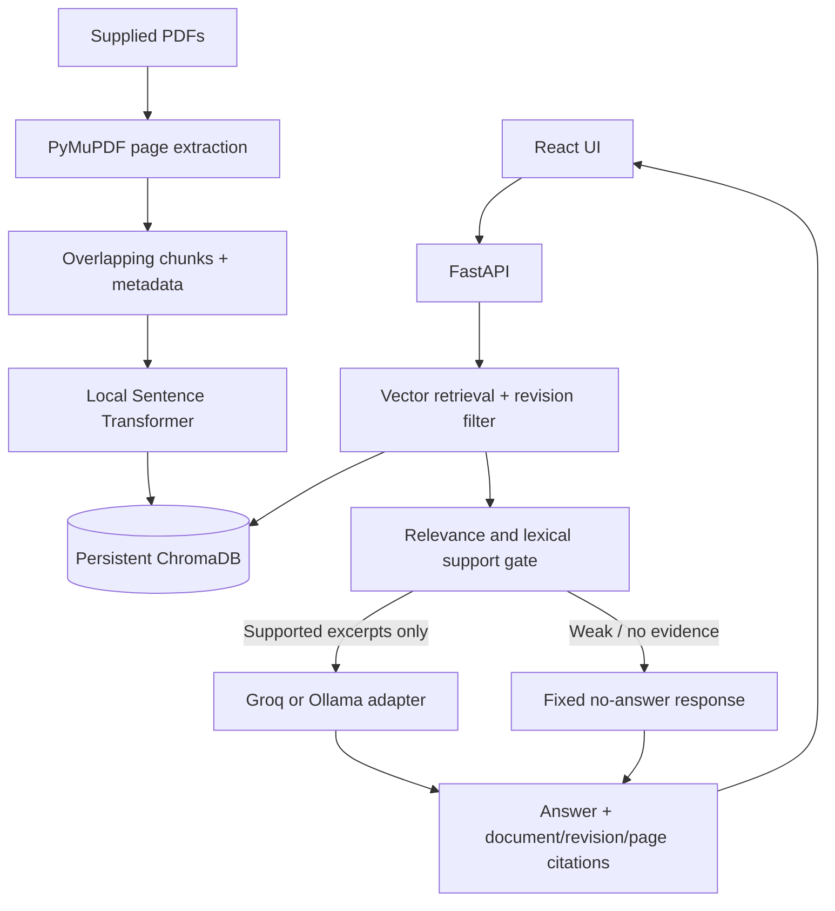

# ShopFloor AI Copilot

ShopFloor AI Copilot is a local-first document assistant for Kaveri Precision Components. It is designed to help shop-floor staff find relevant passages in maintenance, quality and safety PDFs, with source revision and page citations.

> **Status:** the supplied procedure PDFs have been extracted and indexed locally (four answer-source PDFs, seven page-level chunks). Backend unit tests pass, the frontend production build succeeds, and FastAPI health, document listing and unsupported-question refusal have been exercised. No Groq key or Ollama service is configured, so model-generated answers have not been run. The evaluation table below records source-checked retrieval results, not generated model output.

## Business problem

Finding a specific instruction in long PDFs is slow during a shift. A grounded retrieval workflow can surface a short answer with its source so the supervisor can verify it. This application does not replace controlled documents, safety controls, or authorized supervision.

## Key features

- PDF extraction with PyMuPDF, page-level chunking and local Sentence Transformer embeddings.
- Persistent ChromaDB index with file-hash change detection and a separate ingestion command.
- Revision filtering by document number and effective date; API document records show current and superseded states, while historical revisions remain available for explicit lookup and comparison.
- Groq generation by default and a separate Ollama HTTP adapter.
- Relevance threshold and lexical anchor gate; fixed no-answer response when the retrieved evidence is weak.
- Source document, revision and page citations; safety-aware response styling.
- Responsive React/Vite UI with loading, error, empty and shift quick action states.
- Searchable, resumable, deletable chat history stored locally in the current browser (up to 50 conversations).
- Multi-turn follow-up context helps resolve references while answers remain grounded in retrieved document excerpts.
- SQLite-backed signup and login, hashed passwords, editable account profiles, password changes, and per-account browser chat history.
- Admin-token protected re-index endpoint.

## Screenshots

Add reviewed desktop and mobile screenshots here after running the application.

## Technology

Python 3.11+, FastAPI, Pydantic, Uvicorn, PyMuPDF, Sentence Transformers, ChromaDB, Groq SDK, Ollama HTTP API, React, Vite, JavaScript, custom CSS and pytest.

## Architecture



## Repository layout

```text
backend/app/main.py                     FastAPI endpoints
backend/app/config.py                   Environment configuration
backend/app/services/auth_service.py    Local account and session handling
backend/app/services/ingestion_service.py PDF extraction and indexing
backend/app/services/retrieval_service.py Vector search
backend/app/services/revision_service.py Revision selection
backend/app/services/answer_service.py  Grounded answering
backend/app/services/llm/               Groq, Ollama and provider factory
backend/scripts/ingest_documents.py     Separate indexing command
backend/tests/                           Unit tests
frontend/src/                            React app, reusable source card, API client, CSS
data/Documents/                           Supplied PDFs
assessment/                              Six assessment deliverables
```

## RAG and revision workflow

Ingestion walks each PDF page, extracts sorted text, infers document number/revision/title/effective date from PDF text where possible (with filename fallback for revision), divides text into overlapping 700-word windows, embeds locally and writes text plus metadata to ChromaDB. File hashes prevent re-indexing unchanged PDFs. Tables are extracted as PDF text; complex table layout still requires validation against the real files.

For each question, vector search returns up to five excerpts. The revision selector groups chunks by document number. A current question keeps the latest effective revision when all effective dates are available, with revision number as a fallback when dates are missing. An explicit `Rev NN` query keeps that revision; a comparison naming two revisions retrieves both and keeps their instructions separate. Chunks from historical revisions remain stored. When effective dates are incomplete, the response discloses that limitation.

Only gated excerpts are sent to the configured generation provider, never whole PDFs. The embedding model is cached locally during ingestion and query-time embedding runs in local-only mode. The no-answer wording is: “I could not find this information in the available documents. Please consult the relevant department or authorized supervisor.” The similarity threshold and lexical anchor are conservative heuristics, not proof that every generated statement is supported.

## Requirements and installation

Install Python 3.11+ and Node.js LTS. From PowerShell:

```powershell
cd D:\ShopFloor_AI_Copilot
python -m venv backend\.venv
backend\.venv\Scripts\Activate.ps1
python -m pip install -r backend\requirements.txt
Copy-Item backend\.env.example backend\.env
```

## Code formatting

Frontend JavaScript, JSX, CSS, HTML, JSON, and Compose YAML use Prettier. Format or check them from `frontend`:

```powershell
npm run format
npm run format:check
```

Python uses Black with isort import ordering. Install the development tools and format or check the backend and tests from the repository root:

```powershell
python -m pip install -r backend/requirements-dev.txt
python -m isort backend
python -m black backend
python -m isort backend --check-only
python -m black backend --check
```

VS Code is configured to format on save. Install the recommended Prettier and Python formatter extensions for editor formatting.

### Environment configuration

Edit `backend/.env`:

```dotenv
LLM_PROVIDER=groq
GROQ_API_KEY=your-key-here
GROQ_MODEL=openai/gpt-oss-20b
OLLAMA_BASE_URL=http://localhost:11434
OLLAMA_MODEL=llama3.1
EMBEDDING_MODEL=sentence-transformers/all-MiniLM-L6-v2
CHROMA_PATH=backend/data/chroma_db
DOCUMENTS_PATH=data/Documents
TOP_K=5
SIMILARITY_THRESHOLD=0.95
ADMIN_TOKEN=replace-with-a-long-random-value
AUTH_DATABASE_PATH=backend/data/users.sqlite3
AUTH_SECRET_KEY=replace-with-a-random-secret-of-at-least-32-characters
CORS_ORIGINS=http://localhost:5173,http://127.0.0.1:5173
```

`AUTH_SECRET_KEY` signs 12-hour login sessions; set it to a private random value of at least 32 characters before signup. User records are stored in the ignored `backend/data/users.sqlite3` file, and passwords are stored as salted scrypt hashes. Chat history is stored in the current browser and separated by account. Groq keys stay in backend environment configuration and are never sent to frontend JavaScript. For Ollama, set `LLM_PROVIDER=ollama`, configure the base URL and model, and start Ollama separately.

## Index documents

The provided PDFs are in `data/Documents`; the backend and Docker configuration use this path by default. Run from repository root:

```powershell
$env:PYTHONPATH = (Resolve-Path backend).Path
python backend\scripts\ingest_documents.py
```

The command reports PDF count, files newly indexed and chunk count. It reuses unchanged file hashes. Use `force=True` from a trusted administration script to rebuild an index. The HTTP re-index endpoint requires `X-Admin-Token` matching `ADMIN_TOKEN`.

## Run locally

Backend terminal:

```powershell
$env:PYTHONPATH = (Resolve-Path backend).Path
uvicorn app.main:app --app-dir backend --host 127.0.0.1 --port 8000
```

Frontend terminal:

```powershell
cd frontend
npm install
npm run dev
```

Open `http://localhost:5173`. FastAPI OpenAPI docs are at `http://127.0.0.1:8000/docs`. Vite proxies `/api` requests to the backend.

## Run with Docker

Install Docker Desktop and make sure its Linux container engine is running. The Compose setup runs FastAPI and serves the built React app through Nginx, which forwards `/api` requests to the backend. Open the app at `http://localhost:8080` and FastAPI docs at `http://localhost:8000/docs` (or the configured ports). Both ports bind to the local machine only. The backend receives secrets at runtime through Compose; no `.env` file is copied into either image.

The backend reads secrets from `backend/.env`. If that file does not exist, copy the example and set a Groq key (or configure Ollama), a private `ADMIN_TOKEN`, and a random `AUTH_SECRET_KEY` of at least 32 characters. Do not overwrite an existing `backend/.env`:

```powershell
if (-not (Test-Path backend/.env)) { Copy-Item backend/.env.example backend/.env }
```

Docker Compose also reads host port overrides and the Docker Hub username from the root `.env`. Copy `.env.example` to `.env`, then replace `DOCKERHUB_USERNAME` with your Docker Hub username (frontend defaults to `8080`, backend to `8000`). The root file contains no application secrets. Keep Groq, admin and authentication secrets in `backend/.env`.

```powershell
if (-not (Test-Path .env)) { Copy-Item .env.example .env }
```

Build and start the services from the repository root:

```powershell
docker compose up --build -d
```

The document PDFs are mounted read-only from `data/Documents`. To add another PDF, copy it into that folder on your computer; no image rebuild or container restart is needed. The application does not currently provide a PDF upload screen. Run the ingestion command below both on the first setup and after adding or replacing PDFs. It downloads and caches the embedding model on its first run, then indexes new or changed files into the persistent Chroma store:

```powershell
docker compose run --rm -e PYTHONPATH=/app/backend backend python backend/scripts/ingest_documents.py
```

The command skips unchanged PDFs, so it is safe to run again. Once it completes, refresh the app to ask questions about the new document.

Then reload the app at `http://localhost:8080` and create or sign into an account. The SQLite user database and Chroma index stay in the ignored `backend/data` folder on the host, so existing local accounts and indexed documents are available in Docker too. Downloaded embedding model files persist in a Docker volume. To stop the services, run `docker compose down`; this keeps account and index data. Avoid `docker compose down -v` unless you intend to delete the downloaded model cache volume as well. The host bind-mounted account and Chroma data remain on disk.

For Ollama running on the host, set `OLLAMA_BASE_URL=http://host.docker.internal:11434` in `backend/.env` before starting Compose.

### Docker troubleshooting

- If Docker reports that it cannot connect to the daemon, start Docker Desktop and wait for its Linux engine to become ready.
- If a host port is already in use, set a different `FRONTEND_PORT` or `BACKEND_PORT` in root `.env`, then recreate the services with `docker compose up --build -d`.
- If signup fails, confirm `AUTH_SECRET_KEY` is at least 32 characters and check backend logs with `docker compose logs backend`.
- If chat reports a missing API key, configure `GROQ_API_KEY` in `backend/.env` or switch to a configured Ollama provider.
- The first embedding-model download needs network access. Later runs reuse the `huggingface-cache` volume.
- If no documents appear, confirm PDFs are under `data/Documents` and run the ingestion command above; check errors with `docker compose logs backend`.

## Continuous integration

GitHub Actions runs on pushes and pull requests targeting `main`:

- `ci.yml` builds the frontend, checks Python formatting and syntax, then runs the backend test suite.
- `docker-build.yml` builds both Docker images with Buildx and GitHub Actions layer caching. Pull requests only validate the builds; pushes to `main` and tags matching `v*` publish to Docker Hub.

### Publish and pull Docker Hub images

Create Docker Hub repositories named `shopfloor-ai-copilot-backend` and `shopfloor-ai-copilot-frontend`. Create a Docker Hub access token with write access, then add these repository secrets in GitHub under **Settings → Secrets and variables → Actions**:

- `DOCKERHUB_USERNAME`: your Docker Hub username.
- `DOCKERHUB_TOKEN`: the Docker Hub access token (do not use your account password).

After the secrets are configured, pushing to `main` publishes both images with `main`, `latest`, and commit SHA tags. Pushing a version tag such as `v1.0.0` publishes that version and commit SHA. The workflow does not publish images for pull requests. Docker Hub credentials are used only by the publishing workflow and are not included in the images.

To pull and run the published images on a machine with Docker Desktop, set your Docker Hub username in the root `.env` and use the same backend environment setup described above:

```powershell
docker login -u YOUR_DOCKERHUB_USERNAME
docker compose pull
docker compose up -d
```

Set `IMAGE_TAG` in root `.env` to select a version tag instead of `latest`. To return to building from the local source, run `docker compose up --build -d`.

The CI workflows use no application API keys. Run the source checks locally from the repository root:

```powershell
cd frontend
npm ci
npm run build
cd ..
python -m pip install -r backend/requirements-dev.txt
$env:PYTHONPATH = (Resolve-Path backend).Path
python -m isort backend --check-only
python -m black backend --check
python -m pytest backend\tests
```

## Local network deployment

For a private Wi-Fi pilot only, run Uvicorn with `--host 0.0.0.0`, keep Vite on its configured `0.0.0.0` host, find the laptop's private IPv4 address with `ipconfig`, add `http://<laptop-ip>:5173` to `CORS_ORIGINS` in `backend/.env`, and permit Python/Node ports 8000/5173 in Windows Firewall for a Private profile. A second device visits `http://<laptop-ip>:5173`. This was not network-verified in this environment. Do not expose the development servers publicly.

A production factory deployment needs authentication, role authorization, TLS, approved document management, audit controls, backups and security review.

## API

- `GET /api/health`: service status, indexed chunk count and configured provider.
- `GET /api/documents`: indexed document/revision list, including `is_current` and `superseded_by`.
- `POST /api/chat`: `{ "question": "..." }`, 3–1000 characters; returns answer, sources, revision note and safety flag.
- `POST /api/admin/reindex`: requires `X-Admin-Token`; rebuilds index.

## Tests

After installing the dependencies, from repository root:

```powershell
$env:PYTHONPATH = (Resolve-Path backend).Path
pytest backend\tests
```

The unit suite covers overlap chunking, current versus explicit historical revision selection, and an answer-support lexical anchor. Test execution is pending dependency availability. End-to-end evaluation also requires successful real PDF indexing and a configured Groq or Ollama provider.

## Ten-question evaluation record

The five original questions were extracted from `Sample_Questions.pdf`. That file is deliberately kept out of the answer index so the assistant cannot cite the evaluation questions as procedure evidence. Each question below was run through local Chroma retrieval. Evidence-backed summaries are transcribed from retrieved passages; they are not represented as Groq-generated outputs. To finish generation evaluation, configure `GROQ_API_KEY` and approve sending the retrieved excerpts to Groq, or configure a running local Ollama model.

| # | Question | Source-checked result and citation | Retrieval |
|---|---|---|---|
| 1 | What is the recommended coolant concentration for the TX-200 CNC turning centre? | 6–8%. [MNT-MAN-CNC-02 Rev 02, p. 1](data/Documents/MNT-MAN-CNC-02_TX-200_Preventive_Maintenance.pdf) | Retrieved |
| 2 | The machine is showing alarm AL-104. What does it mean and what should the operator do? | Way lube oil level low. Top up with ISO VG 68 oil to the MAX mark, then press RESET; the manual says the machine can continue after reset. [MNT-MAN-CNC-02 Rev 02, p. 2](data/Documents/MNT-MAN-CNC-02_TX-200_Preventive_Maintenance.pdf) | Retrieved |
| 3 | Who is allowed to remove a lockout lock from a machine? | Each authorized person removes only their own lock; nobody may remove another person's lock. [SAF-SOP-003 Rev 05, p. 1](data/Documents/SAF-SOP-003_Lockout_Tagout_Procedure.pdf) | Retrieved |
| 4 | What is the outer diameter tolerance for the BH-220 bearing housing? | 90.000 ± 0.050 mm, measured with a digital caliper; classified Major. [QC-SOP-014 Rev 04, p. 2](data/Documents/QC-SOP-014_Rev04_Incoming_Material_Inspection.pdf) | Retrieved |
| 5 | How often should spindle runout be checked, and who does it? | Monthly, by a maintenance technician. [MNT-MAN-CNC-02 Rev 02, p. 1](data/Documents/MNT-MAN-CNC-02_TX-200_Preventive_Maintenance.pdf) | Retrieved |
| 6 | For lot size 501 to 3,200, how many samples are inspected and what minor defects are allowed? | Inspect 32 samples; accept up to one minor defect and reject at two or more. Any critical defect rejects the complete lot and sorting is not allowed. [QC-SOP-014 Rev 04, p. 1](data/Documents/QC-SOP-014_Rev04_Incoming_Material_Inspection.pdf) | Retrieved |
| 7 | What happens if the supplier MTC is missing? | Put the lot on HOLD; it must not be inspected or accepted until the MTC is received. [QC-SOP-014 Rev 04, p. 2](data/Documents/QC-SOP-014_Rev04_Incoming_Material_Inspection.pdf) | Retrieved |
| 8 | Where are rejected incoming materials stored under the current procedure? | Quarantine Cage Q1, Stores Bay 3; the cage is locked and the key is held by the Shift QC Supervisor. The Shift QC Supervisor informs the SQE within four hours. [QC-SOP-014 Rev 04, p. 2](data/Documents/QC-SOP-014_Rev04_Incoming_Material_Inspection.pdf) | Retrieved |
| 9 | How did incoming inspection sampling change from Rev 03 to Rev 04? | Rev 03 uses five random samples regardless of lot size. Rev 04 uses its lot-size-based table. [QC-SOP-014 Rev 03, p. 1](data/Documents/QC-SOP-014_Rev03_Incoming_Material_Inspection.pdf), [Rev 04, p. 1](data/Documents/QC-SOP-014_Rev04_Incoming_Material_Inspection.pdf) | Both revisions retained; historical lookup tested |
| 10 | What is the fire assembly point? | “I could not find this information in the available documents. Please consult the relevant department or authorized supervisor.” No source is cited. | API refusal tested |

**Generation status:** questions 1–9 have not been sent to an LLM, and their outputs above are reference summaries from source passages, not application-generated answers. Questions 1–9 passed the local retrieval relevance/lexical gate in the evaluation run. Question 10 returned the application's exact no-answer response through FastAPI.

## Known limitations and future improvements

- Groq generation and Ollama generation remain untested because no key or local service is configured. Before enabling Groq, approve external processing of retrieved excerpts.
- Same-Wi-Fi deployment has not been network-verified.
- Metadata extraction uses simple patterns; confirm every PDF's control fields.
- Scanned PDFs/OCR and table validation on production documents need stronger handling.
- Revision filtering uses maximum revision number and should be replaced with approved effective-date/applicability rules.
- Add real retrieval evaluation, answer claim-to-citation checks, authentication, roles, audit logging, document approval, offline support and operational safety review.

## Assessment deliverables

- `assessment/01_user_understanding.md`
- `assessment/02_user_journey.md`
- `assessment/03_ai_challenge.md`
- `assessment/04_build_decisions.md`
- `assessment/05_deployment_guide.md`
- `assessment/06_final_reflection.md`

The final reflection file explicitly leaves personal-experience statements for the author to complete honestly.
